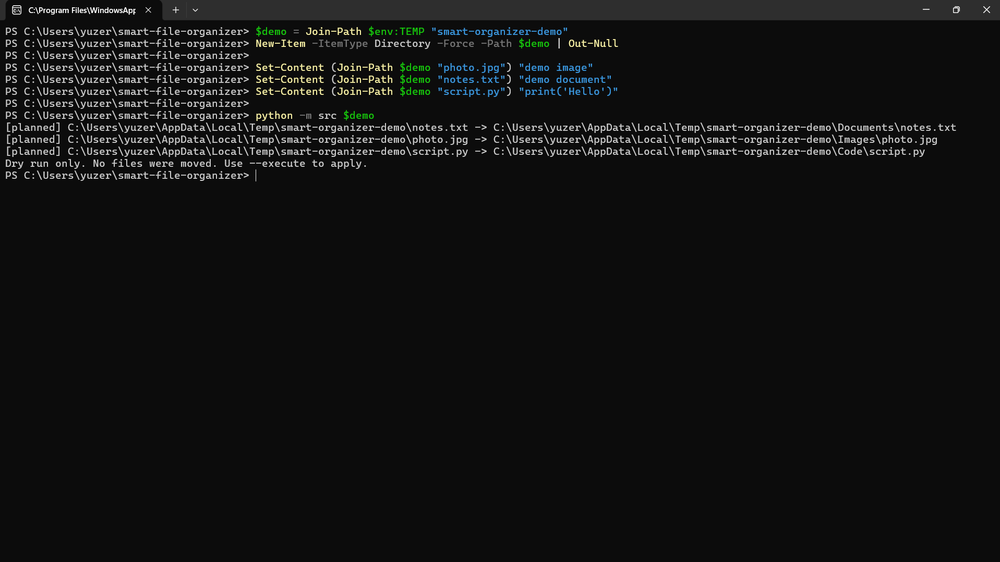

# Smart File Organizer

A lightweight Python CLI tool that organizes files by type, previews planned changes, detects duplicate file contents with SHA-256, and exports JSON reports.

Built with Python, with a focus on safe file operations, clear reporting, and automated testing.

## Features

- **Dry-run by default** — preview planned moves without changing files.
- **Automatic classification** — sort files into categories based on file extensions.
- **Duplicate detection** — identify files with identical content using SHA-256 hashes.
- **JSON reports** — export planned operations, completed moves, skipped files, errors, and optional duplicate groups.
- **Conflict protection** — avoid overwriting files that already exist at the destination.
- **Change detection** — check file content before deleting the original during organization.
- **Error handling** — report file-operation failures and preserve the source when a move cannot be completed safely.
- **Automated quality checks** — pytest, coverage reporting, Ruff, and GitHub Actions CI.

## Demo

The organizer previews file moves without modifying the source directory.


## Requirements

- Python 3.10 or newer
- pip

The application itself has no third-party runtime dependencies. Development tools are available through the optional `dev` dependency group.

## Quick Start — Windows PowerShell

Clone the repository:

```powershell
git clone https://github.com/cybokruvlad/smart-file-organizer.git
cd smart-file-organizer
```

Create and activate a virtual environment:

```powershell
py -3 -m venv .venv
.\.venv\Scripts\Activate.ps1
```

Install development dependencies:

```powershell
python -m pip install -e ".[dev]"
```

Check the available options:

```powershell
python -m src --help
```

## Usage

### 1. Preview organization

Start with a dry run. This is the default behavior and does not move files.

```powershell
python -m src "C:\Users\YourName\Downloads"
```

The tool prints the planned destination for each eligible file.

### 2. Execute organization

After reviewing the preview, apply the changes explicitly:

```powershell
python -m src "C:\Users\YourName\Downloads" --execute
```

Files are placed into category folders inside the selected directory.

### 3. Export a JSON report

```powershell
python -m src "C:\Users\YourName\Downloads" --report ".\organizer-report.json"
```

To execute the organization and save a report:

```powershell
python -m src "C:\Users\YourName\Downloads" --execute --report ".\organizer-report.json"
```

### 4. Include duplicate detection

```powershell
python -m src "C:\Users\YourName\Downloads" --duplicates --report ".\organizer-report.json"
```

Duplicate detection groups files by content hash. It does not delete duplicate files.

Combine it with execution when needed:

```powershell
python -m src "C:\Users\YourName\Downloads" --execute --duplicates --report ".\organizer-report.json"
```

Replace the example Downloads path with the directory you want to organize.

## File Categories

The current extension mapping includes:

| Category | Example extensions |
|---|---|
| Images | `.png`, `.jpg`, `.jpeg`, `.gif`, `.webp`, `.bmp`, `.svg` |
| Videos | `.mp4`, `.mkv`, `.mov`, `.avi`, `.webm` |
| Documents | `.pdf`, `.doc`, `.docx`, `.txt`, `.rtf`, `.odt` |
| Spreadsheets | `.csv`, `.xls`, `.xlsx`, `.ods` |
| Audio | `.mp3`, `.wav`, `.flac`, `.aac`, `.ogg` |
| Archives | `.zip`, `.rar`, `.7z`, `.tar`, `.gz` |
| Code | `.py`, `.js`, `.ts`, `.html`, `.css`, `.json`, `.yml`, `.yaml` |
| Other | Extensions not listed above |

The organizer currently processes files directly inside the selected source directory. Duplicate detection searches files recursively.

## Safety Notes

- Always review the dry-run output before using `--execute`.
- Test with a disposable directory before organizing important files.
- Existing destination files are not intentionally overwritten.
- If the source changes during organization or an operation fails, review the report and both source and destination files.
- Duplicate detection identifies matching content; it does not remove duplicates.
- Keep backups of important files. No file organizer can eliminate every possible filesystem or hardware failure.

## Development

Run the test suite:

```powershell
python -m pytest -v
```

Run tests with coverage:

```powershell
python -m pytest --cov=src.organizer --cov-report=term-missing
```

Run Ruff:

```powershell
ruff check .
```

Format Python code:

```powershell
ruff format .
```

## Project Structure

```text
smart-file-organizer/
├── .github/
│   └── workflows/
│       └── ci.yml
├── src/
│   ├── __main__.py
│   └── organizer.py
├── tests/
├── .gitignore
├── pyproject.toml
└── README.md
```

## Technology

- Python
- pathlib and filesystem APIs
- SHA-256 hashing
- JSON reporting
- pytest and pytest-cov
- Ruff
- GitHub Actions

## License

This project is licensed under the MIT License. See [LICENSE](LICENSE) for details.
